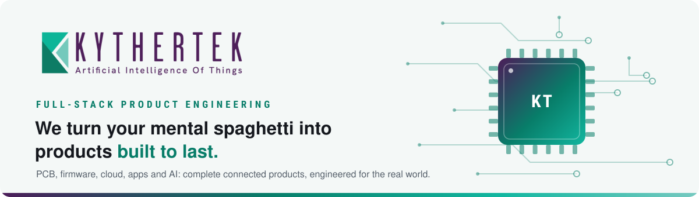
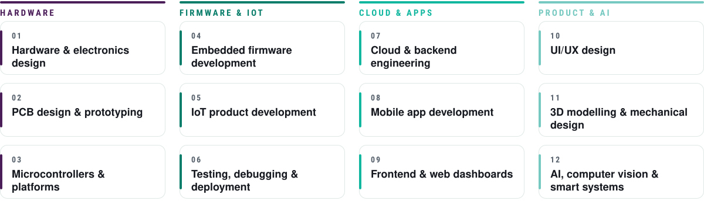

<picture>
  <source media="(prefers-color-scheme: dark)" srcset="assets/hero-dark.svg">
  
</picture>

 

## End-to-end engineering for smart hardware and software

From PCB and firmware to cloud, apps and AI, we build complete connected products, engineered to work in the real world, from proof of concept and prototype through MVP and pilot to production.

<picture>
  <source media="(prefers-color-scheme: dark)" srcset="assets/capabilities-dark.svg">
  
</picture>

## Idea to deployment, in five stages

<picture>
  <source media="(prefers-color-scheme: dark)" srcset="assets/stages-dark.svg">
  
</picture>

## Technology for the physical world

`Consumer electronics` `Smart home & automation` `Energy & utilities` `Industrial monitoring` `Healthcare & assistive tech` `Agriculture & livestock` `Safety & emergency devices` `Computer vision` `IoT monitoring platforms` `Connected wearables`

## Our stack

<table>
<tr><td><b>Firmware &amp; hardware</b></td><td>         </td></tr>
<tr><td><b>Languages</b></td><td>        </td></tr>
<tr><td><b>Connectivity &amp; IoT</b></td><td>       </td></tr>
<tr><td><b>Cloud &amp; DevOps</b></td><td>         </td></tr>
<tr><td><b>Apps &amp; web</b></td><td>       </td></tr>
<tr><td><b>Data</b></td><td>    </td></tr>
<tr><td><b>AI &amp; vision</b></td><td>     </td></tr>
<tr><td><b>3D &amp; design</b></td><td>    </td></tr>
</table>

<picture></picture>

### Have an idea for a hardware, IoT or AI product?

**Tell us what you're building:** [kythertek.com](https://kythertek.com) · [admin@kythertek.com](mailto:admin@kythertek.com)

<b>KytherTek</b> · Office 1104, National Science & Technology Park, NUST H-12, Islamabad

